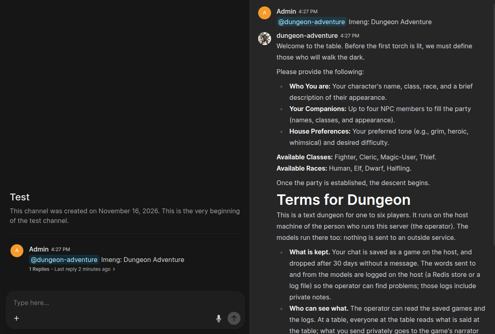
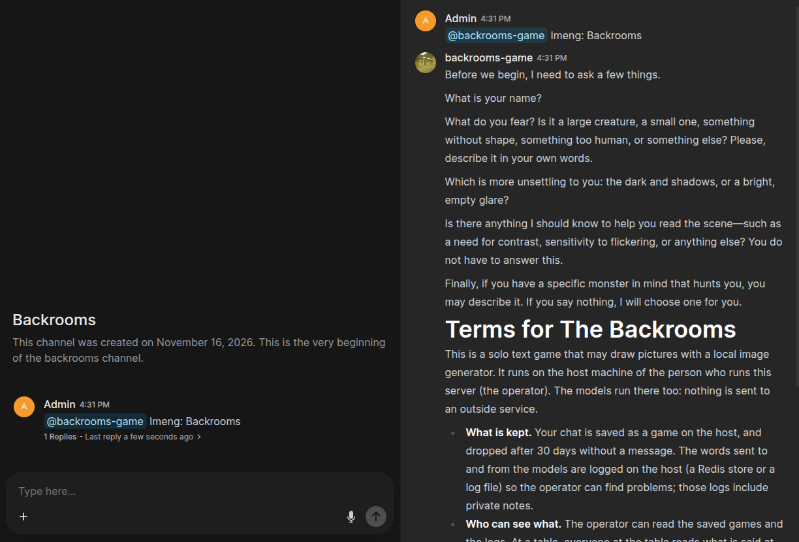
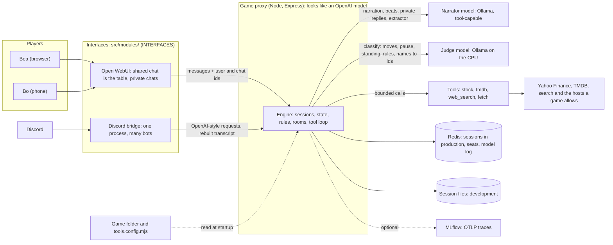

# imeng (Internet Magic Engine)

An Express server that sits between **Open WebUI** and **Ollama** and turns any chat model into a stateful text game (RPG, game show, interactive fiction...).

LLMs are bad at remembering state, so the server owns it. The model only narrates. The server tracks HP, inventory, who has left the game, standing rules and so on, injects that state into every prompt, and updates it after each turn.

A game is a folder of files. The system prompt is the game.

Contributing or changing the code? Read [docs/PRINCIPLES.md](docs/PRINCIPLES.md) first: it lists the design principles to protect (generic engine, state kept outside the LLM, models on the host's hardware) and the working conventions.

## Screenshots

Dungeon Adventure in an Open WebUI channel:



Backrooms, same setup:





The full request flow is under docs/ARCHITECTURE.md. Several people can play one game at a table: see docs/OPERATIONS.md "Multiplayer". In production the sessions live in Redis and several proxy servers can share them: see docs/OPERATIONS.md "Running modes and sessions".


## The Name

Understanding the name will help understand this project.

The beta was just called "engine" and IM&T was originally "Imagine Magic & Technology". "Imagination Engine" is one way to think of the name but the other is "Internet-Magic-Engine".

**Simple**: Engine or em-Engine
**Accurate**: em-gem (__in a gem__)

## Quick start

```bash
npm install
npm run env:init               # writes .env with random secrets (never overwrites)
docker compose up -d           # Redis + Redis Commander (response log), see docs/OPERATIONS.md "Running in Docker"
npm start                      # builds with Vite, then runs dist/server.js on :3001 (loads .env)
```

### Running from source (the way I run it)

Four terminals, plus Ollama if it is not already a service. Replace the angle-bracket parts.

```bash
# Terminal 0 (optional if Ollama already runs as a service)
OLLAMA_CONTEXT_LENGTH=16384 OLLAMA_KEEP_ALIVE=15m OLLAMA_MODELS=<YOUR_MODELS_DIR> OLLAMA_HOST=0.0.0.0:11434 ollama serve

# Terminal 1 (only needed the first run: creates the database tables)
docker compose -f docker-compose.yml up postgres migrate
# Ctrl+C when it is done

# Terminal 2: the backing services
docker compose -f docker-compose.yml up redis redis-commander postgres rustfs

# Terminal 3: every game on one port (debug on; bound to the Docker bridge so Open WebUI in Docker can reach it)
ENABLE_DEBUG=1 PROXY_BIND=172.17.0.1 npm run hub:ephemeral

# Terminal 4: Open WebUI
cd <path to open-webui> && docker compose -f docker-compose.yaml up open-webui
```

Then add an OpenAI connection in Open WebUI to `http://host.docker.internal:3001/v1` (see "Docker-compose for open-webui" at the end). Optional tracing: `docs/MLFLOW.md`. Models: `docs/MODELS.md`. Security notes: `SECURITY.md`.

Requires Node 22.9+ (`engines` is `>=22.9.0 <23`, the oldest LTS line still in support, for `--env-file-if-exists`, which scripts and tests still pass to skip `.env`). The project is TypeScript; see "Development" below. To run it in Docker instead, see docs/OPERATIONS.md "Running in Docker".

The default game in `./imengs/dungeon-game` is a simple AD&D-style **Dungeon Adventure**. Start it by sending `Imeng: Dungeon Adventure` as your first message. Any other first message gives ordinary chat with the model (see docs/CONFIGURATION.md "Game mode vs direct mode"). A slow 120-day horror, **The Lighthouse** (a sole keeper, a haunting that grows with depth, bad weather and short days, one personal item, relief on day 120), is in `imengs/lighthouse` (`IMENG_PATH=imengs/lighthouse`, first message `Imeng: Lighthouse`). A quiet liminal-space horror, **Backrooms** (the player describes what scares them, any accessibility needs and their own monster, bigger, smaller or the default tall thin lanky one, which pursues them through rooms with pits, drowning, injury and self-closing death doors; `/portrait monster` draws it through the `images` block; it ends with `CREDITS.md`), is in `imengs/backrooms` (`IMENG_PATH=imengs/backrooms`, first message `Imeng: Backrooms`).

In Open WebUI, add an OpenAI-compatible connection pointing at `http://localhost:3001/v1`. A model named after `model_id` in `config.json` appears in the dropdown. An **Ollama connection** pointed at the proxy works too (the same URL without `/v1`): it answers `/api/tags`, `/api/version`, `/api/ps`, `/api/show` and `/api/chat` (newline-delimited JSON) with the game as the only model; the turn is the same as `/v1/chat/completions`.

For reliable per-chat sessions, start Open WebUI with:

```
ENABLE_FORWARD_USER_INFO_HEADERS=true
```

This makes Open WebUI send `X-OpenWebUI-Chat-Id` (confirmed in `backend/open_webui/routers/openai.py`).

### One game per session

Every chat gets its own state, cloned from `initial_state`, with its own rules, cast and snapshots.

- **With the header:** the session key is the chat id. This is the reliable way.
- **Without it (fallback):** a brand-new first turn always starts a fresh game, even if you open every chat with the same message ("Play Lighthouse RPG"). Once the narrator replies, the session is re-keyed on user id + first message + first reply, so identical openers diverge. This relies on Open WebUI sending the reply back unchanged. If it doesn't match, the proxy logs `No saved game ... starting fresh mid-conversation`.

## Command-line flags

```bash
npm start                      # normal: sessions saved to ./saves, Redis log kept
npm run start:ephemeral        # same as: node dist/server.js --no-persist
npm start -- --no-persist      # npm needs the extra "--"
node dist/server.js --help
npm run dev -- --no-persist    # dev runner (vite-node), flags work the same
```

| Flag | Meaning |
|---|---|
| `--system-prompt <file>` | Read the system prompt from this file instead of the game folder's `SYSTEM_PROMPT.md` (also `SYSTEM_PROMPT_PATH`; the flag wins). |
| `--no-telemetry` | Nothing is sent to MLflow, whatever a game or its owner says (also `TELEMETRY=off`; the flag wins; telemetry is otherwise on when MLflow is configured). |
| `DATABASE_URL` | The bookkeeping database (Postgres in Docker, `sqlite:` in tests). Unset: none; a game with `deal` or `betting` set to `server` refuses to start without it and keeps an append-only copy of each hand in `hand_log` (deal and bets, 30 days, deleted after a rollback). `STATE_PROBE_MS` (5000), `STATE_EXIT=off`, `CLEANUP_EVERY_MS`: see docs/DEPLOYMENT.md. |
| `--experiment-per-chat` | MLflow: every chat session is its own experiment, created when missing (also `MLFLOW_EXPERIMENT_PER_CHAT`; the flag wins; off by default). |
| `--no-persist` | Ephemeral run. Nothing is written to `SAVE_DIR`, no saved sessions are loaded, and the file fallback log is disabled. On a keyboard exit (Ctrl+C in a terminal) the proxy **deletes every Redis log entry that this process wrote**, so all sessions created in the run leave no trace, and it prints which sessions were purged. |

Unknown flags are rejected. Entries from earlier runs are never touched. The purge only runs on a keyboard exit (see "Stopping the server"). With `SIGTERM` (`docker stop`), `SIGKILL` or a crash it can't, and that run's entries stay in Redis.

## Stopping the server

How the proxy exits depends on how it was told to:

| Signal | Behaviour |
|---|---|
| **Ctrl+C / Ctrl+\** typed in an interactive terminal (`SIGINT` / `SIGQUIT`) | Clean shutdown: the judge's Ollama that the proxy started is killed, then graceful cleanup runs (in-flight log writes finish; with `--no-persist` this run's Redis entries are purged), then the process **exits by re-raising the original signal**, so the shell sees "killed by SIGINT" (status 130), not a normal exit. Cleanup is capped at 8 seconds. |
| **Anything else**: `SIGTERM` (`docker stop`), `SIGHUP`, or `SIGINT` without a terminal (`kill -INT`, CI) | Kill and go: spawned processes are killed synchronously and the signal is re-raised immediately. Nothing is awaited, caught or logged, so the exit can't hold up anything else. **No graceful cleanup**, so no Redis purge. |

Modules register what they start with `onKill(fn)` (instant, runs on every exit signal) or `onShutdown(fn)` (graceful, keyboard exits only); see `src/utils/shutdown.ts`. `SIGKILL` and crashes can't run any cleanup.

## More documentation

| Doc | What is in it |
|---|---|
| [docs/ARCHITECTURE.md](docs/ARCHITECTURE.md) | The request flow, design principles and the project layout |
| [docs/CONFIGURATION.md](docs/CONFIGURATION.md) | Game files, every `config.json` key, state, dice, setup analysis, languages |
| [docs/OPERATIONS.md](docs/OPERATIONS.md) | Several games and the hub, Docker, sessions, bucket, logs, Discord, tools, environment variables, endpoints |
| [docs/IMENG-MAKING.md](docs/IMENG-MAKING.md) | How to make and change an imeng |
| [docs/MULTIPLAYER.md](docs/MULTIPLAYER.md) | Tables of several real people |
| [docs/MODELS.md](docs/MODELS.md), [docs/MLFLOW.md](docs/MLFLOW.md) | Which model does what; tracing |
| [SECURITY.md](SECURITY.md) | Trust model, prompt-injection stance |

## Development

| Command | What it does |
|---|---|
| `npm run build` | Vite SSR build of `server.ts` to `dist/server.js` (dependencies stay external; `spawn-helper.cjs` is bundled in). |
| `npm run dev` | Runs `server.ts` directly with `vite-node` (loads `.env`). |
| `npm run doctor` | Checks that the hardware, model server, game files and proxy setup fit together (see "Doctor"). |
| `npm run judge` | Builds, then starts the host-side judge Ollama (see docs/OPERATIONS.md "Running in Docker"). |
| `npm run driver -- <command>` | Test cases, prompt build, docs check and change zips (see `docs/DRIVER.md`). Shortcuts: `how-to-test`, `build:prompts`, `check:games`, `zip:changes`. |
| `npm run typecheck` | `tsc --noEmit` over the source and tests. |
| `npm test` | Jest tests. |
| `npm run test:coverage` | Jest with coverage; fails below 85% statements/lines/functions or 75% branches. |

### Doctor

`npm run doctor` checks that your hardware, model server, game files and proxy setup agree, and says what to change when they don't. It reads the real system, so it works on Linux, macOS and Windows.

```bash
npm run doctor                       # report everything, exit 0
npm run doctor -- --bail             # stop at the first warning or failure, exit 1
npm run doctor -- --ignore ollama-exposed --ignore ctx-fit   # accept known trade-offs
npm run doctor -- --probe            # also load the models for real (slow, uses the GPU)
npm run doctor -- --json             # machine-readable
```

Without `--bail` it always exits 0, since it is a report. With `--bail` it exits 1 on the first **warning or failure** it meets and skips the rest. `--ignore <id>` (repeatable) downgrades a finding you have decided to live with to information, so it no longer trips `--bail`. Each finding's id is shown in the JSON output; common ones are listed below.

**What it checks**

| Area | Checks (ids) |
|---|---|
| Runtime | Node version against `engines` (`node-version`) |
| Hardware | RAM (`hw-ram`), CPU, and the GPU and its VRAM: NVIDIA through `nvidia-smi` on Linux and Windows, Apple Silicon as unified memory (`hw-gpu`). AMD and Intel GPUs are not measured, so VRAM estimates are skipped for them. |
| Game | `SYSTEM_PROMPT.md` present (`game-files`), `config.json` sanity (`game-config`), prompt and `dice` agree (`prompt-dice`), trigger sentence and `invocation` agree (`invocation`) |
| Model server | Ollama running, or any OpenAI-compatible server such as llama.cpp (reads its context from `/props`) (`backend`); a start command for your platform if nothing runs; the narrator model installed (`model-installed`); `localhost` used from inside a container (`upstream-container`); Ollama running in Docker (`ollama-in-docker`) |
| Ollama settings | On Linux, the running server's actual `OLLAMA_*` environment (`ollama-env`): LAN exposure (`ollama-exposed`), keep-alive (`ollama-keepalive`), models directory (`ollama-models`) |
| Context | What the game needs per turn and how many exchanges fit (`prompt-size`, `ctx-needed`); beyond the model's trained context (`ctx-trained`); whether weights plus KV cache fit your VRAM (`ctx-fit`); what is loaded right now and how much sits on the CPU (`ctx-offload`) |
| Judge | Where it runs and whether it can be reached or started (`judge-target`, `judge-reachable`); its model installed (`judge-installed`); RAM or VRAM fit, including a GPU judge competing with the narrator (`judge-fit`); `judge-ctx`, `judge-models-dir` |
| Proxy | Port free (`port`), Redis reachable (`redis`) |
| `--probe` | A real 1-token request to the narrator (`probe-narrator`) and the judge (`probe-judge`) |

**How the context and VRAM estimate works.** From Ollama's `/api/show` it reads the model's per-layer KV layout (heads, head sizes, sliding-window pattern) and computes the KV cache for your context length, plus the model's size from `/api/tags`, plus a safety margin (8% of VRAM, at least 1.5 GiB). For sliding-window models such as Gemma it gives the *likely* size (sliding layers cache only their window) and the *upper bound* (every layer caches the full context). If only the upper bound overflows it reports information, not a warning, because many runners do exploit the window. The estimate is a guide; `/api/ps` (what is really loaded) and `--probe` are the ground truth.

`--probe` loads the narrator for real at your server's context and reads back from `/api/ps` how much landed on the CPU. If part did, it tries smaller contexts (up to four, in steps of 2048) until one loads fully on the GPU, and suggests that. It sends the context per request, so it does not change your server's settings, but it does leave the model loaded for your `OLLAMA_KEEP_ALIVE`. If the judge's own Ollama is not running yet it skips the judge probe.

**Limits.** Token counts are estimated (about 4 characters per token). Reading the server's environment only works on Linux, for processes you own; elsewhere the doctor uses what the API reports. llama.cpp and other OpenAI-compatible servers get only the basic checks, and cannot serve the judge, which needs Ollama's native API. The doctor does not run inside the Docker image.

### Preflight (the doctor at startup)

The server can run the doctor's checks before it starts and refuse to start if any check **fails**, so a broken setup stops at the door instead of misbehaving mid-game:

```bash
npm start -- --preflight                              # or: PREFLIGHT=1
npm start -- --preflight --preflight-ignore model-installed   # accept a known failure (repeatable)
```

Only warnings and failures are printed (or "all N checks passed"). Warnings are shown but never block; a failure prints the reason, `Refusing to start`, and exits 1 before anything is started (no Redis connection, no judge process, no port opened). In Docker, set `PROXY_PREFLIGHT=1` (passed to the container as `PREFLIGHT`): for example, a host judge that isn't running yet makes the container exit 1, and `PROXY_RESTART=unless-stopped` retries until it is up. Without preflight, a port that is already taken is still reported clearly (`Port 3001 is already in use...`) and the process exits 1.

### Tests

Tests run under Jest in ESM mode with `ts-jest`. They need no network, Ollama, Redis or Docker:

- **Ollama** is faked by replacing `fetch` with a scripted stand-in (`tests/fake-ollama.ts`) that plays the narrator, state extractor and judge.
- **Redis** is replaced by a small fake client (`tests/fake-redis.ts`).
- **MLflow** is a stubbed `fetch`: the tests check the OTLP/JSON that would be sent.
- **The spawn helper** is mocked when testing the judge instance, and also tested on its own against real child processes.
- Each file points the app at fixtures (`tests/fixtures/game`, `alt`, `plain`, `multiplayer`, `multiplayer-tension`, `domains`...) and throwaway save/log directories, so nothing touches `./saves` or `./logs`.
- `--no-persist` behaviour is tested by mocking the CLI module, one test file per configuration.

The three tiny entry points (`server.ts`, `judge-host.ts` and `doctor.ts`) are not unit-tested; their logic lives in `src/utils/` (`bootstrap.ts`, `doctor-settings.ts`, `doctor-format.ts`), which is. The entry points themselves were checked by running them (real signals, Docker, a taken port, failing preflight).

## Known limitations

- **Sync delay:** after each reply, extraction plus the CPU judge takes roughly 15-18s. If the player answers faster than that, the next narration waits.
- **Judge reliability:** the judge model's quality limits rule lifting. A lift has been observed getting its first vote, but a full end-to-end lift has not been tested.
- **Setup analysis is strict:** its evidence must be an exact quote from the user's messages, so some real details get dropped. The state extractor often fills the gap (name, class).
- **Rules only turn off:** there is no way yet to activate a new rule mid-game.
- **Setup analysis quality:** it depends on the judge model. In testing it got the NPC/user split right, but small models drop details (for example "super hunky" was lost) and can write vague descriptions.
- **Fallback sessions:** without the chat-id header, two chats from the same user that open identically *and* get identical first replies would share a session. Use the header.
- **Judge for the Docker setup is a separate process:** you have to start `npm run judge` on the host yourself. Compose does not start it; with `PROXY_PREFLIGHT=1` the container waits for it by failing fast and restarting (needs `PROXY_RESTART=unless-stopped`).
- **Host Ollama exposure:** if your main Ollama listens on `0.0.0.0` (as `OLLAMA_HOST=0.0.0.0:11434` does), it is reachable from your LAN without authentication. The compose setup does not change that.
- **Not public-hardened beyond this:** no TLS, rate limiting or per-user keys; see "Before exposing it to the internet".
- **Narrator context:** if your Ollama runs with a very large `OLLAMA_CONTEXT_LENGTH` (e.g. 32768), a big narrator model may not fit fully on the GPU. Lowering it is likely a bigger speed win than any proxy change.
- **Module type:** `package.json` has `"type": "module"`, so the CommonJS spawn helper lives in `src/utils/spawn-helper.cjs` (unchanged) with a `spawn-helper.d.cts` for types. Vite bundles it into `dist/server.js`.
- **Multiplayer is new:** it is covered by tests with faked models but has not been run against real ones. The proxy trusts the user-id header Open WebUI forwards (keep the proxy off the public internet or set `PROXY_API_KEY`), a private note goes to the narrator and could be repeated in a reply the whole table reads, and timeouts are only checked when someone sends the next message (the proxy cannot post into a chat). Waiting for the narrator model to be free on a shared GPU is not built yet.
- **Tools, Redis sessions and the interface split are new:** covered by tests (the Redis ones against a real Redis, see `docs/DEPLOYMENT.md`) but not yet run live against Yahoo, TMDB or a real narrator. Saved state is not migrated when `config.json` changes. A session grows with every turn (all snapshots are kept for rollback). The Discord bridge is tested against a pretend Discord but its discord.js adapter has not been run against real Discord (`docs/DISCORD.md`). Image generation, a GPU lease and the docker-compose one-shot are not built yet (`docs/DEPLOYMENT.md`, `docs/TOOLS.md`).
- **Machine-specific config:** `judge_instance.models_dir` is where the judge's Ollama finds its models. It depends on your install, so set it (or the `OLLAMA_MODELS` environment variable) for your machine.


# Docker-compose for open-webui

Changed network to host machine ollama

Changed the provider to be:

Ollama default 11434 port: `http://host.docker.internal:11434`
Proxy: `http://host.docker.internal:3001`

Slava Ukraini 🇺🇦

