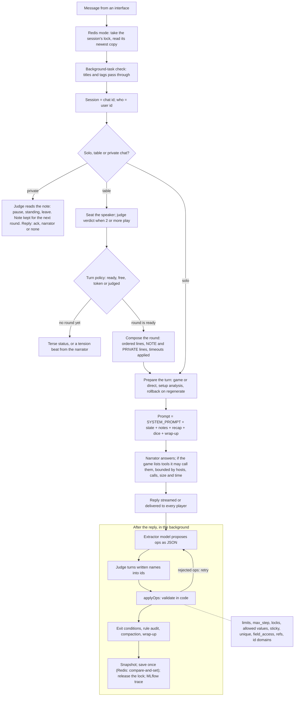

# Architecture and project layout

## Architecture

The proxy presents itself to Open WebUI as an ordinary OpenAI-compatible model. Behind that endpoint it is a stateful game engine: the language models write the story and propose changes, and **code owns the state, the rules and the control flow**. One message goes through the engine like this:



Design principles:

- **The model narrates; the server keeps the truth.** Numbers, rules and who is in the game live in a snapshot of state the narrator cannot overwrite.
- **Proposals, not commands.** A second model call extracts what changed as small JSON ops. Code validates each op (limits, steps, locks, allowed values, field access, ids) and rejects what breaks a rule; rejected ops are retried with feedback.
- **Small judge models only classify.** The CPU judge answers narrow questions (is this a move, a pause, a standing instruction, which entry does a name mean, may a rule lift). The code applies the answer, and no answer means the plain rules.
- **Player text is untrusted.** Server-owned fields cannot be written, and private notes never reach other players.
- **Optional by default.** Multiplayer, tension beats, private replies, tools, Redis sessions, MLflow tracing and lighter saves are all off until configured.

## Project layout

```
scripts/             entry points and tools (built to dist/ by Vite where marked)
  server.ts          entry point: calls bootstrap() and exits 1 if it could not start (dist/server.js)
  hub.ts             `npm run hub`: one port for every game (dist/hub.js)
  judge-host.ts      host-side launcher for the judge's Ollama, used with Docker (dist/judge-host.js)
  discord-bridge.ts  the Discord bridge process: `npm run discord` (dist/discord-bridge.js)
  doctor.ts          CLI for `npm run doctor`
  sessions.ts        `npm run sessions`: list, export, import, clear sessions in Redis
  driver.mjs/.ts     the testing helper (docs/DRIVER.md); migrate.ts, schema.ts, db-migrate.ts, db-cleanup.ts: the other CLIs
app.ts               Express app: health, debug and the default interface (importable for tests)
engine.ts            one turn of a game, independent of the interface: session, table or private chat, prompt, narrator, tools, state update
src/modules/         interfaces: index.ts (registry, INTERFACES), openwebui/ (the default OpenAI-compatible API), discord/ (spin-up and the bridge: config, routing, transcript, streaming)
tools/               tools the narrator may call: fetch, web_search, tmdb, stock (+ net.ts guarded HTTP, bs.ts option pricing)
tools.config.example.mjs  template for tools.config.mjs (keys and endpoints; keep the real one out of git)
discord.config.example.mjs  template for discord.config.mjs (bots and tokens; keep the real one out of git)
vite.config.ts       Vite SSR build of scripts/*.ts -> dist/
Dockerfile           multi-stage image (Node 22 LTS, non-root, read-only-friendly)
.dockerignore        keeps .env, saves, logs and tests out of the image
jest.config.cjs      Jest (ESM + ts-jest) and coverage settings
tsconfig.json        TypeScript settings (type-check only; Vite does the build)
src/utils/
  cli.ts             yargs flags (--no-persist)
  config.ts          env vars + game files (SYSTEM_PROMPT.md, config.json)
  text.ts            small shared helpers (clone, contentText, norm, ...)
  config-schema.ts   config.json schema and version check
  migrations/        one file per config.json format change (up, down, notes); README there
  migrate.ts         `npm run migrate -- <game dir> [--to N] [--write]`
  types.ts           shared types (GameState, Session, GameConfig, ...)
  state.ts           initial state, op validation/apply, limits, judge view, prompt blocks, dice
  sessions.ts        per-chat sessions, snapshots, saving/loading, fallback keys
  upstream.ts        talking to the narrator model: relay, pass-through, state extraction
  judge.ts           judge model, spawned Ollama instance, game/direct mode, rule judge
  setup.ts           setup analysis (rules and cast from the opening messages)
  conditions.ts      exit_when / exit_group_when condition trees
  compact.ts         compaction: old turns replaced by a recap checked against the numbers
  wrapup.ts          ending the game by size or turn budget
  domains.ts         id domains, reference fields (refs), add/drop of entries
  refs.ts            names written for a reference field matched to ids by the judge
  ids.ts             id generators (uuid 4/5/7, random, number, counter, timestamp, hash)
  durations.ts       "5d", "2 hours": real and in-game durations
  multiplayer.ts     a table: players, turn policies, ordering, away, standing instructions
  table.ts           tension beats and private chats (the narrator outside a round)
  room-judge.ts      the judge's reading of a message at a table
  seats.ts           who sits at which table (memory, file and Redis)
  mlflow.ts          optional MLflow tracing over OTLP/JSON
  logger.ts          Redis response log (and the --no-persist purge)
  sink.ts            what the engine needs from an interface (Inbound, Sink) and the Express Sink
  store.ts           sessions in Redis: per-session lock, compare-and-set, maintenance
  sessions-cli.ts    export, import, list and clear sessions (used by sessions.ts)
  production.ts      what a production start tells the operator
  tools.ts           the tool loop: bounded calls, results as untrusted data
  tools-config.ts    reads tools.config.mjs
  shutdown.ts        graceful-shutdown registry
  spawn-helper.cjs   CommonJS child-process helper (spawns the judge's Ollama), used as-is
  spawn-helper.d.cts type declarations for the helper
  auth.ts            optional API-key middleware (PROXY_API_KEY)
  doctor.ts          the doctor's checks (hardware, model server, prompt, judge, proxy)
  doctor-sys.ts      the real machine behind the doctor's `Sys` interface
  doctor-settings.ts the app's configuration as the doctor sees it (also used by --preflight)
  doctor-format.ts   the doctor's human-readable report
  bootstrap.ts       optional preflight, then load sessions, Redis, judge, listen
tests/               Jest tests, fixtures (tests/fixtures/*) and fakes for Ollama and Redis
docs/                guides (below); SECURITY.md at the root
docs/MULTIPLAYER.md       multiplayer, lighter saves, ids and references
docs/MLFLOW.md            MLflow tracing with docker compose
docs/MODELS.md            which model does what, and what an imeng controls
docs/TOOLS.md             tools, their limits and safety, the stock tool's time travel, adding a tool
docs/DEPLOYMENT.md        development and production modes, Redis sessions, sync, export/import, interfaces
docs/DISCORD.md           the Discord interface: setup, config, how conversations are rebuilt
docs/IMENG-MAKING.md       how to add and change a game (stamped with the config format it documents)
imengs/            ready-made games (dungeon-game, lighthouse and backrooms); each has a VISION.md (what the game is for and what is still to build)
```

