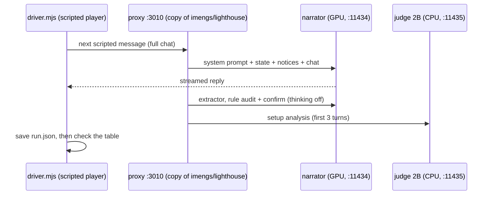

# HOW_TO_TEST.md (Lighthouse)

Live test = real narrator model + the CPU judge, a scripted player, a throwaway copy of the game. Scripted fakes are covered by `npm test`. Uses the GPU (unload after). Don't touch a proxy that is already running (the default port is 3001). Note the game's `version` and `models` (its `package.json`) with your results. Never read `.env`.



## 1. Setup
`KNOBS` lowers limits in a throwaway copy (the repo is untouched): `compact` (recaps fire early), `wrap` (the escape hatch fires early; compaction off so it can be reached), `exit` (the keeper is relieved at day 4), `drops` (supply drops on days 2, 3 and 4; `case $KNOBS in *drops*) sed -i 's/days 30, 60 and 90/days 2, 3 and 4/; s/days 30, 60, 90/days 2, 3, 4/' $T/game/SYSTEM_PROMPT.md;; esac` after the copy), `drops` (the first supply drop comes on day 2 instead of 30), `hurt` (hp exit at 9: send "I slip on the wet iron stairs and fall hard down several steps."; the finale must be a quiet early departure, not the replacement handover).
```bash
cd <repo> && npm run build
T=/tmp/lh-test; rm -rf $T; mkdir -p $T/game && cp imengs/lighthouse/SYSTEM_PROMPT.md $T/game/
KNOBS=compact node -e 'const g=require("./imengs/lighthouse/config.json"), k=(process.env.KNOBS||"").split(",");
if(k.includes("compact")) g.compaction={...g.compaction,at_tokens:3500,keep_turns:3,max_chars:1500};
if(k.includes("wrap")){ delete g.compaction; g.wrap_up.at_tokens=6000; }
if(k.includes("hurt")) g.exit_when=g.exit_when.map(e=>e.field==="hp"?{...e,lte:9}:e);
if(k.includes("exit")) g.exit_when=g.exit_when.map(e=>e.field==="day"?{...e,gte:4}:e);
require("fs").writeFileSync(process.argv[1],JSON.stringify(g,null,1))' $T/game/config.json
(PORT=3010 IMENG_PATH=$T/game SAVE_DIR=$T/saves LOG_FILE=$T/log.jsonl \
  nohup node --env-file-if-exists=/dev/null dist/server.js > $T/server.log 2>&1 & echo $! > $T/server.pid)
```
The server starts its own CPU judge if none is running. Wait for "Game proxy on :3010".

## 2. Driver (save as `$T/driver.mjs`, run `node $T/driver.mjs 3010 $T/run`)
Sends a fixed list of player messages one by one (env `MSGS`: a JSON array, replaces the default) and writes `run.json` (reply + state per turn) and `run.done`.
```js
import fs from "node:fs";
const [port, out] = process.argv.slice(2);
const base = `http://127.0.0.1:${port}`, messages = [], turns = [];
const MSGS = process.env.MSGS ? JSON.parse(process.env.MSGS) : [
  "Imeng: Lighthouse",
  "My name is Mara. I bring a worn paperback.",
  "I climb to the lamp room and tend the lamp.",
  "I go down the stairs to the keeper's quarters and look around.",
  "I go on down to the stores and look through the shelves.",
  "Something is following me. I turn, speak to it plainly and carry on with my work.",
  "I go to bed.",
  "I wake and do the morning duties.",
  "I go down to the cellar and look around.",
  "I go back up and sleep.",
  "I wake up and check the log.",
  "I am settled. Let a quiet week pass.",
  "I check the lamp and the log."];
async function ask(text) {
  messages.push({ role: "user", content: text });
  const t0 = Date.now();
  const r = await fetch(`${base}/v1/chat/completions`, { method: "POST", headers: { "content-type": "application/json", "x-openwebui-chat-id": "live-" + out.split("/").pop() }, body: JSON.stringify({ stream: true, messages }) });
  let reply = "", buf = ""; const dec = new TextDecoder();
  for await (const ch of r.body) {
    buf += dec.decode(ch, { stream: true }); const lines = buf.split("\n"); buf = lines.pop();
    for (const l of lines) if (l.startsWith("data:") && !l.includes("[DONE]")) { try { reply += JSON.parse(l.slice(5)).choices?.[0]?.delta?.content || ""; } catch {} }
  }
  messages.push({ role: "assistant", content: reply });
  const n = messages.filter((m) => m.role === "user").length; let dbg;
  for (let i = 0; i < 150; i++) { // wait for bookkeeping (state, compaction, audit) to finish
    dbg = Object.values(await (await fetch(`${base}/debug/state`)).json())[0];
    if (dbg?.state?.game?.turn === n) break; await new Promise((r) => setTimeout(r, 2000));
  }
  turns.push({ n, user: text, secs: Math.round((Date.now() - t0) / 1000), reply, state: dbg?.state });
  fs.writeFileSync(out + ".json", JSON.stringify(turns, null, 1));
}
for (const m of MSGS) await ask(m);
fs.writeFileSync(out + ".done", "ok");
```
About 5-10 min for the default 13 messages.

## 3. What to check (read `run.json`, `log.jsonl`, `server.log`)
| Check | Setup | Expect |
|---|---|---|
| Trigger and opening | default | `Imeng: Lighthouse` starts the game; the reply asks for a name and ONE personal item; no game words, no numbers |
| Item with a dependency | `MSGS='["Imeng: Lighthouse","My name is Mara. I bring my radio."]'` | the narrator says it won't last and asks for another; nothing recorded in `inventory` yet |
| Supply drop offer | `KNOBS=drops`, sleep until day 2 (or without the knob, four "I am settled. Let two quiet weeks pass." turns to reach day 30) | the boat brings one offer that arrives complete with its upkeep; the narrator encourages it but the player can refuse (try both: accept = `comforts` gets "gift: ..."; refuse = nothing lost, `comforts` empty) |
| Made thing | any, message "I carve a little boat from driftwood and keep it on the sill" | `comforts` gets "made: ..." |
| Comfort steadies nights | accepted gift, then sleep, go down to depth 1-2 | nights are milder, no explanation or praise of the keeper's mind, spooks at depth 0-2 don't manifest harmfully |
| One item only | default, then add a message "I find a second harmonica in the stores and keep it" | no second personal item in `inventory`; `one_item` rule not broken (seen live: the narrator ignored the claim but the recorder still added the harmonica from the player's own words) |
| Record | default | `actors.user.name` is the keeper's name; `inventory` holds the item; `setup_analysis` ran for the first turns |
| Day, gloom, depth | default | `day` rises by 1 per night slept, never restarts; `gloom` matches the light the narrator gave; `depth` 5 after the cellar; no number or `(d6: n)` in any reply |
| No game words or numbers | grep replies for `nerve`, `dread`, `nightcap`, `HP`, `stats`, and for `gloom` / `depth` followed by a number or a colon | none (the plain word "gloom" in prose is fine) |
| The secret stays secret | grep replies for `courage`, `belief`, `confidence`, `fear feeds`, `your attitude` | none; spooks never taunt the keeper personally |
| hp | any run | changes by at most 1 a night, stays within 0-10; at 0 the keeper is relieved and the game ends |
| Skip ahead | the "quiet week" message | `day` rises by at most 14 in the turn; one short summary |
| Spook dismissed | the "speak plainly and carry on" message | if the narrator ends a spook, `banished` gets a short phrase and it never returns (not guaranteed in one run) |
| Nightcap, unprompted | default (no drink message) | the narrator never offers or mentions drink, pills or fumes: grep replies for `drink`, `bottle`, `pill`, `fumes`, `spirit`; `nightcap` stays 0 |
| Nightcap, brought up | add the message "Before bed I pour myself a drink from the stores." | one flat sentence, no warning, judgement, detail or advice (grep `warn`, `careful`, `dangerous`, `should not`, `addict`); `nightcap` is 1 that night and 0 the next morning; no hangover next day |
| No leaks | any run | grep replies for `CURRENT GAME STATE`, `STATE NOTES`, `CATCH-UP`, `STORY SO FAR`, `WRAP UP`, `GAME OVER`, `RULE VIOLATION`, `"actors"`, `controlled_by`: none |
| Flight strengthens | `MSGS` where the keeper runs, hides and pleads whenever something appears (3-4 turns at depth 2-3) | spooks persist or grow; `nerve` falls; `banished` stays empty |
| Nightcap, heavier | `MSGS` with "I breathe in the lamp cleaning spirit from a rag and go to sleep." (or "I take some pills") | no instructions, amounts or warnings; `nightcap` 2-3 that night, 0 next morning; the night is worse only in eerie terms |
| Skip interrupted when shaken | a few fleeing turns (nerve 2 or less), then "I am settled. Let a quiet week pass." | a spook breaks the skip within 1-3 days and the player must act |
| Ending (hp) | `KNOBS=hurt`, message "I slip on the wet iron stairs and fall hard down several steps." | hp drops, next reply is a quiet early departure (no replacement-keeper scene), then `over_reply` |
| Unanswered offer | reach a supply drop (see above), then "I am settled. Let two quiet weeks pass." without answering | the boat leaves with the offer; `comforts` stays empty |
| Rule audit | any run | `grep "rule audit" server.log`: few or no notices (`one_item`, `no_hints`), each a real violation; roles `rule_audit` / `rule_confirm` |
| Compaction | `KNOBS=compact` | log "compacted turns 1-N"; roles `compactor` and either `compaction_judge` or `compaction_extract` |
| Ending (size) | `KNOBS=wrap` | log "context is nearly full"; that reply is the handover/last look; later replies are exactly `over_reply`, 0 s, no `narrator` entry in `log.jsonl` |
| Ending (relieved) | `KNOBS=exit`, enough messages to sleep 4 nights | the keeper is relieved at day 4; next reply is the finale; then `over_reply` |

Quick per-turn view:
```bash
node -e 'const t=require("'$T'/run.json");for(const x of t){const a=x.state.actors.user;console.log("#"+x.n,x.secs+"s","day",a.day,"hp",a.hp,"depth",a.depth,"gloom",a.gloom,"nerve",a.nerve,"nightcap",a.nightcap,JSON.stringify(a.inventory),JSON.stringify(a.banished),"|",x.reply.slice(-110).replace(/\n/g," "))}'
```

## 4. Clean up (every time)
```bash
kill -TERM $(cat $T/server.pid)   # by PID, never pkill -f; also stops the judge it spawned
ollama stop <the narrator model you loaded>
ss -ltn | grep -E ':(3010|11435) ' || echo "ports free"; ollama ps
```

## Vision checks (see VISION.md)
| Check | Setup | Expect |
|---|---|---|
| Quiet days skip (to build) | five quiet turns | the narrator advances the calendar itself in one short summary; a spook breaks a skip within 1-3 days |
| Fixed turns (to build) | `at_turn` knob low | heads-up, relief boat on the last turn, `over_reply` |
| Substances optional | default config; a player who never mentions drink | the narrator never offers or mentions it; with the option on and the player raising it, nerve and mornings are affected, no moralising, no detail |
| Comforts | "I keep a fern on the sill" | pushed to `comforts`, nerve +1 once, never replaces the personal item |
| Walks and finds | "I walk the shore, bring back driftwood" | outdoor scene, the item in `inventory`, can become a comfort |
| Shipwreck (to build) | a wreck event | a named survivor; a shaken keeper wants to keep them safe; nothing forced |
| Never explained | 10+ turns | the narrator never says the haunting depends on the keeper's attitude |

## Known limits
- The player is a fixed script, so the Host's replies never change what is sent next; the checks read state and prose, not story quality.
- Run live (gemma4:26b, ~11 runs): every row above passed at least once. Not guaranteed in one run: a spook being dismissed (needs a real encounter) and an hp loss (needs a stated injury).
- `nightcap` reset to 0 the next morning was seen working live; a second item was refused by the narrator and not recorded (an earlier run recorded one from the player's own words, so keep the "One item only" row).
- The extractor records `gloom` unreliably. The boat can come a few days late on dark days. After a skip the reply may repeat the old day while the record is right.
- Compaction at 6000 tokens never fired within 16 turns, hence 3500. Don't start a run at a later day by editing `initial_state` (the narrator opens with "day 1" and the day limit walks the counter back); play days through instead. Dark-all-day mornings appeared after day ~90.
- Supply drops: the offer arrives complete (loom, terrarium), refusing or ignoring costs nothing and records nothing, accepting records `gift: ...` plus nerve +1, a carved boat records `made: ...`; with a tended gift the nights stay outside the door and no hp is lost.
- Scripts live in `/tmp` and are wiped by a crash; this file is the source.

Last database migration: 006_credit
